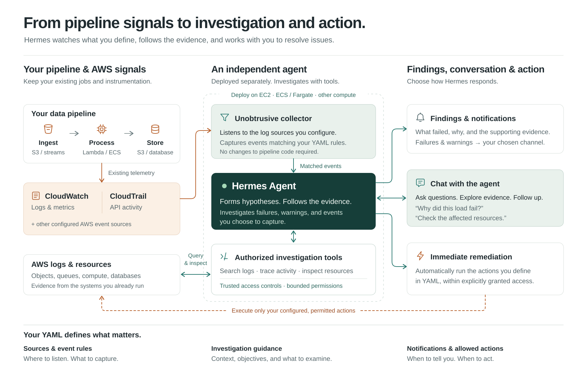

# Hermes Data Reliability



Reproduce failed data loads in AWS and investigate them with Hermes Agent.
You configure log sources and match rules in YAML. A host collector detects
incidents, and Hermes follows the evidence with scoped AWS reads to explain
what failed, propose a fix, or perform automatic remediation you define in
YAML, within explicitly granted permissions.

## Quick start

For a new lab, follow [setup and deployment](docs/SETUP.md). For an existing
lab, use the [operations guide](docs/OPERATIONS.md) to find the current address
and connect from your workstation. Then run **on EC2**:

```bash
sudo labctl start
sudo labctl status
sudo labctl chat
```

Use `sudo labctl pause` to pause the investigator. Synthetic data generation
has a [separate control](docs/OPERATIONS.md#pause-or-resume-synthetic-data-generation).

## Guides

- [Architecture](docs/ARCHITECTURE.md) — data flow, investigation limits, and reporting.
- [Observation configuration](docs/OBSERVATION_CONFIG.md) — log sources, match rules, and prompts.
- [AWS access and tools](docs/ACCESS.md) — authorization and evidence boundaries.
- [Recovery](docs/RECOVERY.md) — backups, restore, and upgrades.
- [Evaluations](docs/EVALUATION.md) — reproducible scenarios and verification.

## Development

Use **Python 3.14**. Run on your workstation, from the repository root:

```bash
python3.14 -m venv .venv
source .venv/bin/activate
python -m pip install -r requirements.txt
```

With the virtual environment active, run the checks from the repository root:

```bash
python -m ruff format --check .
python -m ruff check .
python -m compileall -q investigator pipeline evals tests
git diff --check
```

In VS Code, select this repository's `.venv` and use a Pylance/Pyright version
that supports Python 3.14. Type checking targets Linux, the deployment platform.
