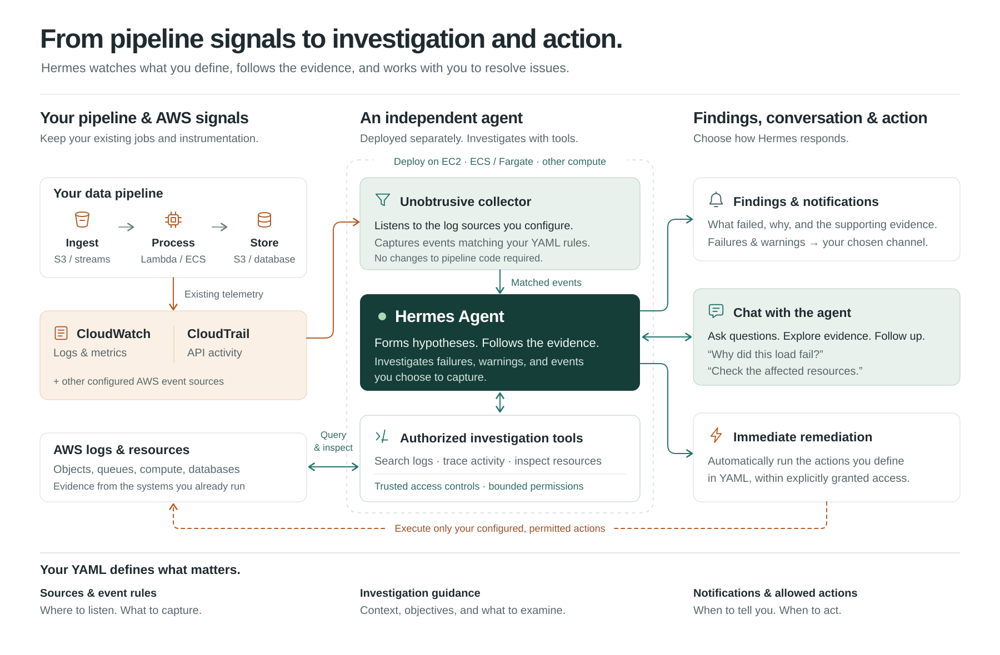

# Hermes Data Reliability



Reproduce failed data loads in AWS and investigate them with Hermes Agent.
You configure log sources, match rules, and delivery expectations in YAML.
One collector saves shared evidence. Independent consumers apply log rules
and scheduled expectations, then save incidents for Hermes to investigate.
Hermes follows the evidence with scoped read-only tools, explains what it can
establish, and proposes a next step for you to review.

## Quick start

For a new lab, follow [setup and deployment](docs/SETUP.md). For an existing
lab, use the [operations guide](docs/OPERATIONS.md) to find the current address
and connect from your local machine. Then run **on the runtime host**:

```bash
sudo labctl start
sudo labctl status
sudo labctl chat
```

Use `sudo labctl pause` to pause the investigator. Synthetic data generation
has a [separate control](docs/OPERATIONS.md#pause-or-resume-synthetic-data-generation).

## Guides

- [Architecture](docs/ARCHITECTURE.md) — data flow, investigation limits, and reporting.
- [Observation configuration](docs/OBSERVATION_CONFIG.md) — log sources, match rules, and prompts.
- [AWS access and tools](docs/ACCESS.md) — authorization and evidence boundaries.
- [Tool boundary package](tool_boundary/README.md) — access checks and limits for agent tool calls.
- [Collector package](collector/README.md) — shared source collection.
- [Observation store](observations/README.md) — saved events and collection coverage.
- [Log-rule consumer](investigator/consumers/log_rules/README.md) — detection from saved logs.
- [Incident storage package](incidents/README.md) — durable queue and attempt accounting.
- [Recovery](docs/RECOVERY.md) — backups, restore, and runtime image changes.
- [Evaluations](docs/EVALUATION.md) — reproducible scenarios and verification.

## Development

Use **Python 3.14**. Run on your local machine, from the repository root:

```bash
python3.14 -m venv .venv
source .venv/bin/activate
python -m pip install -r requirements.txt
```

With the virtual environment active, run the checks from the repository root:

```bash
python -m ruff format --check .
python -m ruff check .
python -m compileall -q \
  observations collector incidents tool_boundary investigator pipeline evals tests
git diff --check
```

In VS Code, select this repository's `.venv` and use a Pylance/Pyright version
that supports Python 3.14. Type checking targets Linux, the deployment platform.
