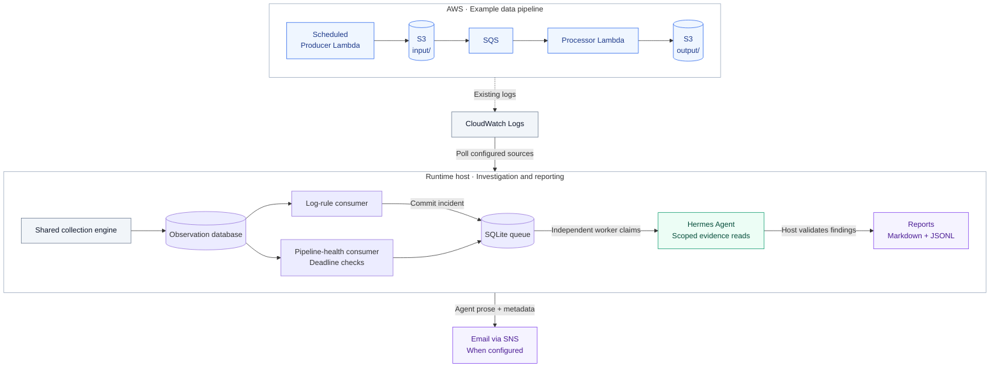

# Architecture

The pipeline writes files and logs. A shared collector saves events, while
independent consumers match symptoms and check declared delivery expectations. Hermes does the detective work and reports what it finds.

## Overview



## Data flow

The producer writes five JSON records each minute, occasionally adding bad data
for the lab. Schedule-derived run IDs and conditional writes prevent duplicate
delivery from replacing input. Scheduler and producer retries are disabled.

S3 notifications go through SQS to the processor. It checks the approved queue,
bucket, and keys, rejects changed/oversized input, and doubles numeric `amount`
values. Files stay in S3, with no database destination:

```text
input/<run-id>.json
output/<run-id>.json
runs/<run-id>/<attempt-id>.json
```

Repeated delivery reuses the output key and creates a new attempt record.
A failed record retries its whole SQS message; exhausted messages go to the DLQ.
Each Lambda can access only its required S3 paths. JSON logs carry run IDs;
processor logs add attempt/SQS IDs and a final per-file `status` for detection.
Input contents and queue bodies are never logged.

## Automatic investigations

The source catalog names provider feeds. Every enabled consumer declares its
subscriptions in its own YAML. A compiler validates the whole graph against
host policy, then merges aliases for the same account, connector, region, and
location. The shortest requested interval and largest lookback and overlap form
one polling plan for each underlying feed. Rules, prompts, consumer names, and
cadence are excluded from source identity.

The collector saves all events and its page cursor in one transaction. Event
identity is source plus native provider ID; a conflicting payload fails the
page. Complete pagination records coverage for that exact window. Incomplete
pages resume; failed reads retry without marking coverage. Connectors share
one provider deadline per poll. AWS connectors use the same credential client
implementation, which checks both host and assumed-role identity.
CloudTrail collects explicitly scoped management-event history; VPC logs use
their configured CloudWatch delivery group. No message broker is required.

Independent timers run collection, log rules, pipeline-health deadlines, and
investigation. Log rules commit idempotent incidents before acknowledging a
bounded saved-event batch. Consumer revisions replay retained evidence using
their own cursors, without resetting ingestion. Reads release their database
transaction before regex evaluation or incident publication. Every subscribed
feed receives a share of the consumer's per-tick budget. Pipeline health runs
on the clock even when no new event arrives.

One worker claims at most one incident per invocation and releases the database
transaction before model calls. A separate process lock coordinates model
investigations, chat, and maintenance. Background consumers do not need that
model lock. Hermes's internal gateway stays stopped. Evaluation tools run only
when requested.

### Package boundaries

| Package | Owns |
| --- | --- |
| `observations/` | Source/event/subscription contracts, retained evidence, coverage, consumer positions, bounded queries and batches |
| `collector/` | Source catalog, polling plan, provider connectors, ingestion, collection audit and status |
| `investigator/consumers/log_rules/` | Rule definitions, bounded matching, saved-event consumption, incident publication |
| `investigator/capabilities/pipeline_health/` | Delivery schedules/identities, expectation adapters/checks, check history, tools and investigation skill |
| `incidents/` | Queue, immutable investigation snapshots, claims, findings and attempt accounting |
| `tool_boundary/` | Authorization, budgets, provider execution, audit and evidence receipts |
| `investigator/runtime/` | Configuration assembly, service lifecycle, central agent orchestration, deployment and recovery |

Collection imports neither incident storage nor investigator code. The shared
observation core and executor use the standard library; YAML parsing runs only
in the existing configuration/consumer environment with pinned PyYAML.
CloudTrail response validation is shared between collection and investigative
tools. The app-owned compiler installs `collection.json`, `log-rules.json`,
and `pipeline-health.json` under `/etc/hermes-lab` after validation. Consumer
definition fingerprints bind those snapshots to the collection plan; a consumer
refuses a partial or mismatched configuration installation. The model
cannot change those files, original evidence, collection progress, or host
control sockets. The executor has read-only access to the observation database.

Capability plugin files and skills remain under `investigator/capabilities/`;
ordinary tools remain under `investigator/tools/`. Deployment selects host code
and model-visible files separately. Package location does not grant access.
On-demand agent tools still read current AWS evidence under their scoped grants;
background subscriptions deduplicate collection, rather than caching every
possible investigation request.

### Extending collection and consumers

Every collection connector extends `collector/connectors/base.py::Connector`.
The shared engine calls the same methods for every registered connector:

| Method | Responsibility |
| --- | --- |
| `validate_definition` | Validate and normalize that connector's catalog fields |
| `prepare_template` | Bind an initial template using trusted host configuration |
| `resolve` | Produce an authorized `Source` with a stable identity |
| `authorize` | Recheck the source against current host policy |
| `read` | Apply the shared deadline, request checks, and authorization before reading |
| `_read` | Execute a bounded provider page and return validated `Event` records in a `Page` |

`collector/registered.py` lists the available classes. The registry rejects
unknown names, duplicate registrations, and abstract implementations. YAML
selects a registered name; it cannot import code. Configuration compilation
and polling both delegate source authorization to that class.

CloudWatch owns log-group validation, its resource allowlist, template binding,
and `FilterLogEvents` requests. CloudTrail owns approved resource names, its
host enablement check, and `LookupEvents` requests. `connectors/aws.py` shares
AWS source validation and account/region checks. `providers/aws/` owns role
identity, credentials, and bounded CLI execution, without service-specific
collection operations. Non-AWS connectors need neither this base nor AWS
configuration.

`collector/definition.py` merges already resolved sources without interpreting
provider fields. `collector/reader.py` dispatches reads and audits attempts,
failures, and completion without recording event bodies or credentials.
`collector/collection.py` owns scheduling, pagination progress, deduplication,
and coverage. Recoverable failures carry an explicit resume flag; the engine
does not recognize provider error strings.

To add a connector, implement the class in `collector/connectors/` and add its
registration in `collector/registered.py`. Extend trusted deployment policy
and IAM where needed. A connector owns any additional catalog selectors and
stores their normalized values in `Source.options`. Its stable source key must
include every selector that changes the returned evidence, together with the
provider identity and scope. Aliases and consumer schedules must not change
that key. Preserve native event identity and original payloads; reject malformed
or out-of-scope responses instead of returning an empty successful page. The
planner and observation database need no connector-specific changes. Consumers
still validate which event formats they understand.

A new consumer declares the common manifest from `observations/subscriptions.py`
and owns its rules, validation, service entry point, and progress semantics in
its package. Its configuration class implements the shared configuration
interface described below. The collector needs no consumer-specific logic.
`observations/delivery.py` supplies bounded event batches;
`incidents/publication.py` supplies idempotent incident publication.
Consumer-specific failures must not advance its acknowledged position or become
collection errors.

A new pipeline-health check belongs in its check registry. It selects a
compatible registered adapter, which resolves approved evidence and describes
coverage. Checks using existing JSON events reuse `collected_events`; they do
not add another CloudWatch poller. Add an adapter only when evidence needs a
different query or observation shape. SQS/Lambda metadata tools remain separate
investigation tools; their existence does not imply message-level detection.

### Configuration packages

`investigator/runtime/observation_configurations.py` registers the installed
configuration packages once. Each `ConfigurationSpec` declares an identifier,
operator YAML filename, compiled filename, trusted provider class, and optional
template path relative to the compiler's template directory. Without an explicit
template path, the template uses the YAML filename. These registrations are
Python code supplied by the installation; YAML cannot select a module or class.

Every provider implements `observations/configurations/base.py::Configuration`:

| Method | Responsibility |
| --- | --- |
| `load` | Read and validate the package definition, binding an initial template where appropriate |
| `sources` | Contribute authorized source definitions; consumers normally contribute none |
| `consumers` | Expose subscription manifests; the source catalog contributes none |
| `validate_graph` | Check package constraints against resolved sources, host policy, and the combined collection plan |
| `compile` | Return the package's JSON configuration after graph validation |

The source catalog class lives in `collector/configuration.py`; log rules and
pipeline health have their own `configuration.py` in their packages. Source
catalog compilation produces the shared collection plan. Consumer compilation
produces the consumer definition. Log-rule source-format and matcher checks
belong to its class; pipeline-health resource binding and tool enablement belong
to its class. The standalone pipeline-health installer uses that same class.

`configure_observations.py` selects installed YAML or initial templates, asks
each provider for its sources and consumers, builds one collection plan, and
validates every package against it. It prepares all serialized outputs before
installing any file. Existing operator YAML, including comments, stays intact;
an explicit catalog replacement is validated before replacing that file.
Individual file replacements are atomic. A failed sequence of writes can leave
inconsistent compiled revisions, which consumers reject until you recompile.

Snapshot, restore, reset, and status read file metadata from the same registry.
They do not maintain separate filename lists. Provider imports occur only when
loading configuration, so inventory and backup do not require YAML parsing or
capability dependencies. The reset archive includes every registered YAML and
compiled file and restores them together if replacement fails.

To add an installed configuration package, implement its class and add one
`ConfigurationSpec` registration. Its files then participate in compilation and
the file lifecycle automatically. Its service activation and permissions remain
explicit deployment responsibilities. The compiler's `--consumer` option adds
subscription requirements for planning only; it does not install a configuration
package or start a consumer.

### Claims and durability

Each claim atomically saves a unique ownership token, ten-minute lease, and
attempt charge. Only the current, unexpired token can save findings. After
interruption or reboot, the lease must expire before another automatic attempt;
spent attempts remain charged. Recovery opens a fresh session under current
host authorization.

SQLite uses a rollback journal, `synchronous=EXTRA`, a five-second busy timeout,
and short transactions. EXTRA also synchronizes the directory after journal
deletion; see [SQLite durability](https://www.sqlite.org/pragma.html#pragma_synchronous).
Use persistent local storage that honors synchronization. Committed state
survives process loss/reboot; volume loss needs backups.

Reports export from committed snapshots, including on idle worker ticks.
A crash between saving and exporting findings needs no extra model call.
JSONL and Markdown are derived views; SQLite is authoritative. A collector
reset archives findings/queue, keeps attempt budgets, and sets a new start
that overlap cannot cross. Shared observations retain seven days within fixed record and byte caps;
incident attempts and findings have no automatic retention.

### Detection scope

Lab run/attempt matches get scoped S3/log tools. Plain-text matches need no run
ID and get log access within ±5 minutes. Both use the same worker, budgets,
and host citation checks. YAML cannot expand access.

Default rules detect explicit processor file failures. Producer failures,
malformed notifications, queue outages, silent stoppages, and overdue output
need rules or declared expectations. The pipeline-health capability detects
absent expected objects or configured events after their deadlines without requiring
an error log. It does not detect incomplete or incorrect contents. Delivery
retries and investigation attempts are separate. There is no automatic
remediation or incident database retention policy.

### Pipeline-health capability

The package separates schedule enumeration, delivery identity mapping, evidence
adapters, and registered deterministic checks. Daily UTC and anchored interval
schedules can use date, timestamp, or SHA-256 identities. The S3 adapter resolves
relative keys through host-approved resource profiles; checks evaluate its
observations without assuming cadence or key naming. The collected-event
adapter queries shared coverage and configured JSON fields, allowing delayed
ingestion before declaring an event absent. The package owns its
configuration validation, tool adapter,
investigation skill, and schedule runner. The standalone boundary accepts an
explicit trusted `ToolExtension`; its default service has no capability
dependency. The installed application entry point supplies pipeline health.
Neither plugin discovery nor the model can load a host extension.

A separate timer runs up to eight due checks within a shared 25-second deadline
through the same executor,
authorization, audit, and check implementation used by chat. Healthy checks
make no model calls. Failed or unknown observations enter a durable outbox;
the runner commits each to the incident queue before acknowledging it.
The central worker handles `health` incidents with the existing leases,
attempt limits, and finding validation. There is no second investigator.
You define each pipeline's investigation objective and instructions alongside
its expectations in the operator YAML. The outbox saves those settings with
the original check, and the queue retains that snapshot for investigation.
The capability skill defines tool usage and the finding/citation contract.

History and outbox state live outside the model container in
`/var/lib/hermes-lab-executor/pipeline-health.sqlite3`. Current-session receipts
can cite saved checks while preserving their original observation times.
The skill is supplied as trusted instructions to both automatic investigations
and chat. Session scope restricts an automatic investigation to its delivery,
exact configured evidence keys, and nearby approved logs. Definition revisions and source
identity are revalidated when opening the session.

See [configuration and limits](OBSERVATION_CONFIG.md#pipeline-delivery-expectations).

## Interactive chat

Chat uses the same worker, plugins, and executor with a resource scope.
Follow-ups share the remaining budget. Exit, expiry, revocation, disconnect,
or executor restart ends access; history cannot restore it.

Collection continues during chat; automatic investigations wait without spending
attempts. History stays under `/srv/hermes-lab/hermes/`; answers are not saved
as findings automatically. Automatic citations are host-validated; chat citation
use also relies on runtime instructions.

## Investigation limits

Chat and automation share `investigator/runtime/config.yaml`: provider, model,
reasoning, turns, run budget, API retries, recovery cycles, and enabled plugins.
Deployment installs it at `/srv/hermes-lab/hermes/config.yaml`, mounted at
`/opt/data/config.yaml`. Hermes loads it; the worker selects enabled toolsets,
runbook, and CLI input/output mode. See [tool selection](ACCESS.md#tool-packages).
Host access budgets and worker timeouts apply independently.

| Setting | Current value |
| --- | --- |
| Collector tick / default source interval | 15 seconds / two minutes |
| Pipeline-health tick / recheck | 15 seconds after completion / at least one minute |
| Pipeline-health automatic coverage | Due deadlines in the preceding 24 hours; up to eight checks/tick |
| Initial lookback / default overlap | 24 hours / five minutes; set in YAML |
| Collection per invocation | Five pages, 100 events/page, 60-second shared deadline |
| Catch-up windows | Up to two hours each; initial lookback does not cap backlog |
| Regex compile/evaluation | Three seconds/request; 256 MiB worker limit on Linux |
| Automatic attempts | Three per rolling hour; three per incident |
| Investigation tick / retry backoff | 15 seconds after completion / ten minutes |
| Model budget | Ten iterations; 180 seconds |
| Worker timeout / claim lease | 240 seconds plus kill grace / 600 seconds |

Failed and interrupted attempts count. `--retry-incident INCIDENT_ID` skips
pending backoff only, never a live lease or attempt limit. Chat and explicit
verification are outside the automatic hourly limit.

## Code responsibilities

Within the main packages:

- `collector/connectors/`: the common connector contract and provider-specific
  source definitions, authorization, requests, and response validation.
- `collector/providers/aws/`: host/assumed-role identity and bounded AWS CLI calls.
- `collector/registry.py`, `registered.py`, `reader.py`: class registration,
  configured instances, uniform read dispatch, shared deadlines, and audit.
- `collector/definition.py`, `collection.py`, `poll.py`: catalog compilation,
  subscription planning, ingestion progress, and the polling entry point.
- `observations/configurations/`: shared configuration contract, graph context,
  file metadata, and deferred provider loading. Runtime registrations supply
  the installed inventory; each owning package supplies its implementation.
- `investigator/capabilities/pipeline_health/`: expectation validation, exact-key presence
  checks, saved observations/outbox, scheduling, plugin, and investigation skill.
- `incidents/database.py`, `queue.py`, `specification.py`: schema, claims and
  attempt accounting, saved instruction validation.
- `tool_boundary/services/`: service classes own package options, resource
  validation, request authorization, fixed commands, result validation, and
  evidence references. The common interface is `services/base.py`.
- `tool_boundary/registered.py`, `registry.py`, `catalog.py`, `loader.py`: trusted
  registrations, configured instances, normalized YAML/host selections, and
  scope loading. Registration also supplies plugin paths for deployment.
- `tool_boundary/scopes.py`, `policy.py`, `resource_policy.py`, `log_policy.py`:
  trusted context factories, context validation, and shared budget reservations.
- `tool_boundary/providers/`: AWS identity validation, credentials, and transport
  implementations. Service classes validate their own context fields through
  the common `validate_scope` interface.
- `tool_boundary/executor.py`, `results.py`, `receipts.py`: sessions, audit,
  evidence limits, hashes, detached receipts, and fail-closed release.
- `tool_boundary/selection.py`: standalone model-side selection from the host's
  read-only package manifest; it imports no service or policy code.
- `investigator/runtime/findings.py`, `evidence.py`: report structure and the
  common evidence-verifier interface. Session verification resolves exact
  tool-issued citations through the executor; report parsing has no provider
  or capability reference rules.
- `investigator/runbooks/`: model instructions; `runtime/`: deployment, containers,
  investigations, chat, reports; `tools/`: self-contained native plugins.
- `pipeline/producer/`, `pipeline/processor/`: synthetic inputs and SQS processing.
- `infra/aws-agent/`, `infra/aws-pipeline/`: independent Terraform roots.
- `evals/`, `tests/`: manual live scenarios and implementation/access checks.

The boundary service and credentials stay outside the model container. Only its
empty initializer and standalone selector are mounted for toolset selection,
alongside a read-only manifest generated by the host. Service implementations,
policy, credentials, and executor state are not mounted in the model container.
See the [boundary design](ACCESS.md#design-rationale)
and [security limits](ACCESS.md#security-scope-and-next-steps).

Container configuration uses Hermes's bundled `hermes_yaml`; host observation
configuration uses pinned PyYAML.

## Health and storage

Host diagnostics use stderr with UTC time, level, and module; command JSON uses
stdout. Pipeline logs retain their JSON matching fields. Diagnostic logging
never replaces trusted audits or receipts.

A one-minute health timer checks services, disk, worker and pipeline-check heartbeats,
collection progress, exhausted incidents, and a backup within 36 hours. Backup
checks cache for one hour. Pause skips runtime checks but keeps disk/backup
checks. Missing heartbeats alarm; healthy checks make no model calls.
CloudWatch alarms remain active with notification actions disabled.

Reports contain an explanation, uncertainty, references, and proposed action.
Read them at `/srv/hermes-lab/findings/reports/`, or configure `alert_email` for
validated prose and incident metadata via SNS. Evidence stays on the runtime
host; initial email setup skips historical reports.

The host checks account, role, and topic without model calls. Delivery state in
`findings/notifications.sqlite3` survives reboots and collector resets;
unsupported formats are rejected. Reports get up to three attempts, at least
five minutes apart, with one attempt/minute globally. Exhausted reports stay
saved; topic changes never redirect pending messages.

“Sent” means SNS accepted the report; inbox delivery is unverified. A crash
before saving acceptance can cause duplicates.

The default host is `t3.medium`, with 30 GiB encrypted gp3 storage and daily
backups. It uses public IPv4, without NAT, a load balancer, or RDS. Stopping
saves compute charges; storage and other services remain billable. T3 Standard
can throttle sustained CPU use.
