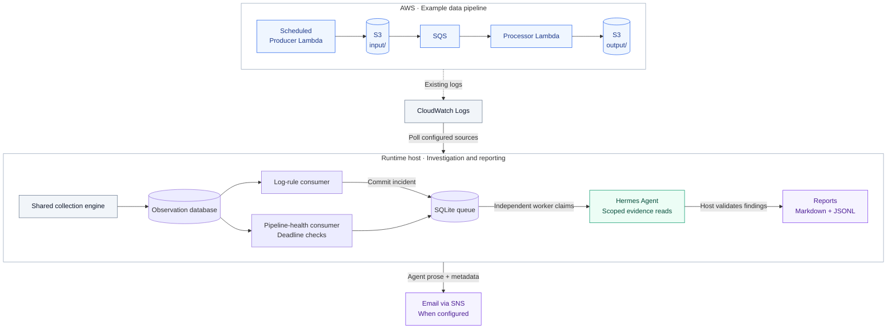

# Architecture

A shared collector saves pipeline events. Independent consumers detect symptoms
and unmet expectations, then publish incidents for one Hermes agent to investigate.

## Runtime hosts

The runtime runs on EC2 or in a local Amazon Linux container. Both use Python
3.14, the same release installer, systemd services and timers, pinned Hermes
image, and isolated tools container. The local host has its own nested Docker
daemon. Rebuilding activates a source release through the same installation
path; configuration and databases live in persistent Docker volumes.

Local execution uses the approved AWS resources and the same investigation
limits. A shared trusted provider supports explicit profiles, instance
credentials, and private credential files with optional role assumption. Local
setup uses your selected profile directly unless you configure a role; EC2
selects its instance role and scoped investigator role. AWS Backup and the EC2
health metric remain specific to EC2; local health checks inspect the same
application services and databases.

## Overview



## Data flow

The lab producer writes five JSON records each minute, sometimes with bad data.
Schedule-derived run IDs and conditional writes prevent duplicate delivery from
replacing input. S3 notifications pass through SQS to the processor, which
validates input and doubles numeric `amount` values. Files stay in S3:

```text
input/<run-id>.json
output/<run-id>.json
runs/<run-id>/<attempt-id>.json
```

Retries reuse the output key and create new attempt records; exhausted SQS
messages go to the DLQ. JSON logs carry run, attempt, and SQS identifiers and a
final per-file status. Input contents and queue bodies are never logged.

## Automatic investigations

Consumers declare subscriptions to a shared source catalog. The compiler merges
requests for the same source into one polling plan.

Separate timers run collection, log rules, pipeline-health checks, and
investigation. Consumers commit incidents before advancing progress, so replay
is safe. One worker claims one incident at a time. Chat and maintenance share
its model lock; collection and consumers continue independently.

### Package boundaries

| Package | Owns |
| --- | --- |
| `observations/` | Shared contracts, events, coverage, consumer positions, bounded queries |
| `aws_access/` | Explicit credential sources, optional role assumption, account and principal validation |
| `collector/` | Source catalog, polling plan, connectors, ingestion and collection audit |
| `investigator/consumers/log_rules/` | Rule validation, bounded matching and incident publication |
| `investigator/capabilities/pipeline_health/` | Delivery expectations, evidence adapters, check history, tools and skill |
| `incidents/` | Queue, instruction snapshots, claims, findings and attempt accounting |
| `tool_boundary/` | Tool authorization, budgets, execution, audit and evidence receipts |
| `investigator/runtime/` | Configuration assembly, services, central agent, deployment and recovery |

Collection imports no investigator or incident code. The observation core and
executor use the standard library; configuration parsing uses pinned PyYAML.
Capability plugins and skills live with their capability; ordinary plugins live
under `investigator/tools/`. Host policy and evidence stay outside the model
container. See [access boundaries](ACCESS.md).

### Collection and observations

The collector saves successful and informational events as well as failures.
It runs independently of consumers and the investigation agent, resumes
unfinished collection after a restart, and records completed ranges and errors.

The observation database stores each event with its source, event identity,
event time, and collection time. Repeated reads keep one copy. Consumers keep
independent positions and can read the same evidence at different speeds.
Retention gaps, partial collection, and failed reads remain explicit; missing
evidence cannot establish absence. See [collection, progress, and coverage](OBSERVATION_CONFIG.md#collection-progress-and-coverage).

### Log-rule consumer

The log-rule consumer applies your configured rules to saved CloudWatch events
and publishes matches with investigation instructions to the shared incident
queue. Rule or prompt changes can replay retained evidence while collection
continues. Failed evaluation leaves unread work in place and records an error.
See [log-rule configuration](OBSERVATION_CONFIG.md#log-rule-consumer).

### Extending collection and consumers

Connectors implement `collector/connectors/base.py::Connector` and register in
`collector/registered.py`. Each class owns its source fields, authorization,
requests, and response validation:

| Method | Responsibility |
| --- | --- |
| `validate_definition` | Validate and normalize catalog fields |
| `prepare_template` | Bind an initial template to trusted host settings |
| `resolve` | Produce an authorized source with a stable identity |
| `authorize` | Recheck the source against current policy |
| `read` / `_read` | Apply shared bounds and return a validated provider page |

Source identity includes provider scope and every selector affecting evidence;
aliases and consumer schedules do not change it. Preserve native event identity
and original payloads. Malformed or out-of-scope responses must fail rather than
appear as empty successful reads. Add reviewed host/IAM permissions as needed;
YAML can select registered connectors but cannot grant access or load code.

A consumer owns its manifest, configuration class, service, and progress.
`observations/delivery.py` provides bounded batches;
`incidents/publication.py` provides idempotent incident publication. Consumer
failures leave its position unchanged without becoming collection errors.

Pipeline-health checks select compatible registered evidence adapters. Existing
JSON events use `collected_events`; add an adapter for a different query or
observation shape. SQS/Lambda metadata tools do not provide message-level detection.

### Configuration packages

`investigator/runtime/observation_configurations.py` registers each package's
YAML filename, compiled filename, trusted provider, and optional template path.
Configuration, snapshot, restore, reset, and status all use this inventory.
Provider imports are deferred, so backup needs no YAML or capability dependencies.

Package-owned classes implement `observations/configurations/base.py::Configuration`:

| Method | Responsibility |
| --- | --- |
| `load` | Read and validate the definition |
| `sources` / `consumers` | Contribute authorized sources or subscription manifests |
| `validate_graph` | Check requirements against the combined plan and host policy |
| `compile` | Produce the package's JSON configuration |

The source catalog produces `collection.json`; consumers produce their own
compiled definitions under `/etc/hermes-lab`. The compiler validates the whole
graph and prepares outputs before writing. Existing operator YAML and comments
stay intact unless explicitly replaced. File replacements are atomic individually;
consumers reject mismatched compiled revisions until you recompile.

Add a class and one registration to include its files in this lifecycle. Service
activation and permissions remain explicit deployment work. `--consumer` adds
planning requirements only; it does not install or start a package.

### Claims and durability

The incident database stores published incidents, their investigation
instructions, findings, and attempts in SQLite. Pending investigations and
attempt counts survive restarts; the central investigator reads this queue.

Claims atomically save an ownership token, ten-minute lease, and attempt charge.
Only the current unexpired claim can save findings. Interrupted attempts remain
charged; a new session revalidates current authorization after lease expiry.

SQLite is authoritative; Markdown and JSONL reports are derived views that can
be exported after a crash without another model call. A collector reset archives
findings and queue while retaining spent attempts. Use persistent storage and
[recovery procedures](RECOVERY.md) for checkpoints and backups.

### Detection scope

Default log rules detect explicit processor file failures. Run incidents get
scoped object/log tools; plain-text matches get logs within ±5 minutes. Other
symptoms need configured rules or expectations. Delivery retries and investigation
attempts are separate. There is no automatic remediation.

### Pipeline-health capability

Schedules, delivery identities, evidence adapters, and checks are independent.
S3 checks inspect exact approved keys; collected-event checks query saved events
and coverage. After a delivery's deadline, missing objects or events can trigger
investigation without an error log. These checks do not establish correct
contents or a complete load. Missing events remain unknown when collection has
gaps or has not allowed enough time for delayed logs.

Chat and the scheduled runner use the same trusted executor and checks. Healthy
checks make no model calls. Failed or unknown observations enter an outbox,
then the shared incident queue. Each incident saves its delivery, definition
revision, objective, and instructions for the central investigator. Its scope is
limited to configured evidence for that delivery and nearby approved logs.

History lives in `/var/lib/hermes-lab-executor/pipeline-health.sqlite3`.
Receipts preserve original observation times. The capability skill supplies
trusted tool and reporting instructions to chat and automatic investigations.
See [expectation configuration](OBSERVATION_CONFIG.md#pipeline-delivery-expectations).
Use [operations](OPERATIONS.md#configure-delivery-expectations) to install changes.

## Interactive chat

Chat uses the same worker, plugins, and executor with a resource scope. Follow-ups
share the remaining budget. Exit, expiry, revocation, disconnect, or executor
restart ends access; saved history cannot restore it.

Automatic investigations wait during chat without spending attempts. Chat history
lives under `/srv/hermes-lab/hermes/`; answers are not automatically saved as
findings. Automatic citations are host-validated; chat citation use also relies
on runtime instructions.

## Investigation limits

Chat and automation share `investigator/runtime/config.yaml`, installed as
`/srv/hermes-lab/hermes/config.yaml`. It selects the model, run budget, retries,
and plugins. Host [access limits](ACCESS.md#current-limits) apply independently.

| Setting | Current value |
| --- | --- |
| Collector tick / default source interval | 15 seconds / two minutes |
| Pipeline-health tick / recheck | 15 seconds after completion / at least one minute |
| Pipeline-health automatic coverage | Deadlines in the preceding 24 hours; eight checks/tick, 25-second deadline |
| Initial lookback / default overlap | 24 hours / five minutes; set in YAML |
| Collection per invocation | Five pages/feed; 100 CloudWatch or 50 CloudTrail events/page; 60-second shared deadline |
| Catch-up windows | Up to two hours each; initial lookback does not cap backlog |
| Regex compile/evaluation | Three seconds/request; 256 MiB worker limit on Linux |
| Automatic attempts | Three per rolling hour; three per incident |
| Investigation tick / retry backoff | 15 seconds after completion / ten minutes |
| Model budget | Ten iterations; 180 seconds |
| Worker timeout / claim lease | 240 seconds plus kill grace / 600 seconds |

Failures and interruptions count. `--retry-incident` skips pending backoff only;
chat and explicit verification are outside the automatic hourly limit.

## Health and storage

Host diagnostics go to stderr with UTC time, level, and module; command JSON goes
to stdout. Pipeline logs retain JSON matching fields. Audits remain separate.

A one-minute health timer checks services, disk, heartbeats, collection progress,
exhausted incidents, and a backup within 36 hours. Backup checks cache for one
hour. Pause retains disk/backup checks. CloudWatch notification actions are
separately disabled by default.

Reports live in `/srv/hermes-lab/findings/reports/`. Optional SNS email sends
validated prose and incident metadata; evidence stays on the host. Delivery
state survives restarts and collector resets. Reports get three attempts, at
least five minutes apart, with one attempt/minute globally. Topic changes never
redirect pending messages. SNS acceptance does not prove inbox delivery, and a
crash before saving acceptance can cause duplicates.

The default host is `t3.medium` with 30 GiB encrypted gp3 storage and daily
backups. Stopping saves compute charges; storage and other services remain
billable. T3 Standard can throttle sustained CPU use.
