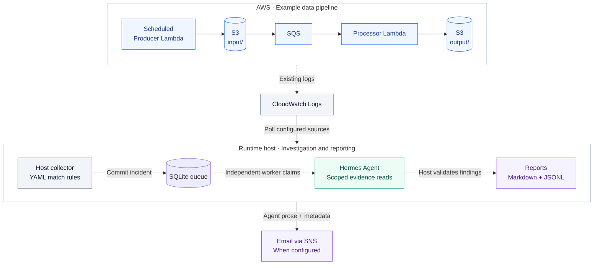

# Architecture

The pipeline writes files and logs. An independent collector watches for
matches; Hermes does the detective work and reports what it finds.

## Overview



## Data flow

The producer writes five JSON records each minute, occasionally adding bad data
for the lab. Schedule-derived run IDs and conditional writes prevent duplicate
delivery from replacing input. Scheduler and producer retries are disabled.

S3 notifications go through SQS to the processor. It checks the approved queue,
bucket, and keys, rejects changed/oversized input, and doubles numeric `amount`
values. Files stay in S3, with no database destination:

```text
input/<run-id>.json
output/<run-id>.json
runs/<run-id>/<attempt-id>.json
```

Repeated delivery reuses the output key and creates a new attempt record.
A failed record retries its whole SQS message; exhausted messages go to the DLQ.
Each Lambda can access only its required S3 paths. JSON logs carry run IDs;
processor logs add attempt/SQS IDs and a final per-file `status` for detection.
Input contents and queue bodies are never logged.

## Automatic investigations

The collector reads sources from `/srv/hermes-lab/observations.yaml`, without
a content filter, then applies literal or Python `re` rules in a bounded worker.
SQLite saves original events, definitions, cursors, and incidents. Matches and
page progress commit together. Failed reads retain unread work; overlap reads
are deduplicated. Rule edits replay history without clearing incidents/attempts.

Collection and investigation have separate systemd timers:
`hermes-lab-poller.timer` and `hermes-lab-investigation.timer`. Collection
continues while Hermes is busy or unavailable. Each investigation tick claims
at most one eligible incident, releasing the database transaction before model
or tool calls. A process lock coordinates investigations, chat, and maintenance.
Both timers activate after boot; saved state determines what is due. Hermes's
internal gateway stays stopped. Evaluation tools run only when requested.

### Package boundaries

| Package | Owns | Dependencies |
| --- | --- | --- |
| `collector/` | CloudWatch reads, matching, progress, collection audit/status | `incidents`, pinned PyYAML |
| `incidents/` | SQLite records, instruction payload contract, claims, attempts | Standard library only |
| `tool_boundary/` | Agent authorization, budgets, execution, audit, receipts | Standard library only; host AWS CLI |
| `investigator/` | Agent prompts, orchestration, chat, reports, deployment | Host packages and configured Hermes runtime |

The collector validates saved instruction payloads but never interprets or runs
them. It imports neither investigator nor tool boundary code. The application
supplies its initial YAML template explicitly; the lab template is
`investigator/runtime/observations.yaml`. Installation uses `collector.configure`;
the service runs `python -m collector.poll`.

Collection and notifications each own their AWS client, with time/output
limits and safe errors. Collection keeps its identity, scope, response, and
audit checks. These operations need no agent grant; investigation orchestration
opens grants for agent work.

### Claims and durability

Each claim atomically saves a unique ownership token, ten-minute lease, and
attempt charge. Only the current, unexpired token can save findings. After
interruption or reboot, the lease must expire before another automatic attempt;
spent attempts remain charged. Recovery opens a fresh session under current
host authorization.

SQLite uses a rollback journal, `synchronous=EXTRA`, a five-second busy timeout,
and short transactions. EXTRA also synchronizes the directory after journal
deletion; see [SQLite durability](https://www.sqlite.org/pragma.html#pragma_synchronous).
Use persistent local storage that honors synchronization. Committed state
survives process loss/reboot; volume loss needs backups.

Reports export from committed snapshots, including on idle worker ticks.
A crash between saving and exporting findings needs no extra model call.
JSONL and Markdown are derived views; SQLite is authoritative. A collector
reset archives findings/queue, keeps attempt budgets, and sets a new start
that overlap cannot cross. Package layout changes do not change saved state.

### Detection scope

Lab run/attempt matches get scoped S3/log tools. Plain-text matches need no run
ID and get log access within ±5 minutes. Both use the same worker, budgets,
and host citation checks. YAML cannot expand access.

Default rules detect explicit processor file failures. Producer failures,
malformed notifications, queue outages, silent stoppages, and overdue output
need other rules or detection work. Delivery retries and investigation attempts
are separate. There is no automatic remediation or database retention policy.

## Interactive chat

Chat uses the same worker, plugins, and executor with a resource scope.
Follow-ups share the remaining budget. Exit, expiry, revocation, disconnect,
or executor restart ends access; history cannot restore it.

Collection continues during chat; automatic investigations wait without spending
attempts. History stays under `/srv/hermes-lab/hermes/`; answers are not saved
as findings automatically. Automatic citations are host-validated; chat citation
use also relies on runtime instructions.

## Investigation limits

Chat and automation share `investigator/runtime/config.yaml`: provider, model,
reasoning, turns, run budget, API retries, recovery cycles, and enabled plugins.
Deployment installs it at `/srv/hermes-lab/hermes/config.yaml`, mounted at
`/opt/data/config.yaml`. Hermes loads it; the worker selects enabled toolsets,
runbook, and CLI input/output mode. See [tool selection](ACCESS.md#tool-packages).
Host access budgets and worker timeouts apply independently.

| Setting | Current value |
| --- | --- |
| Collector tick / default source interval | 15 seconds / two minutes |
| Initial lookback / default overlap | 24 hours / five minutes; set in YAML |
| Collection per invocation | Five pages, 100 events/page, 60-second shared deadline |
| Catch-up windows | Up to two hours each; initial lookback does not cap backlog |
| Regex compile/evaluation | Three seconds/request; 256 MiB worker limit on Linux |
| Automatic attempts | Three per rolling hour; three per incident |
| Investigation tick / retry backoff | 15 seconds after completion / ten minutes |
| Model budget | Ten iterations; 180 seconds |
| Worker timeout / claim lease | 240 seconds plus kill grace / 600 seconds |

Failed and interrupted attempts count. `--retry-incident INCIDENT_ID` skips
pending backoff only, never a live lease or attempt limit. Chat and explicit
verification are outside the automatic hourly limit.

## Code responsibilities

Within the main packages:

- `collector/access.py`, `aws.py`, `audit.py`, `cli.py`: identity/configuration,
  CloudWatch reads, collection audit, and command output.
- `incidents/database.py`, `queue.py`, `specification.py`: schema, claims and
  attempt accounting, saved instruction validation.
- `tool_boundary/catalog.py`: tool selection; `policy.py`, `resource_policy.py`,
  `log_policy.py`: authorization; `executor.py`: sessions, budgets, audit/release;
  `aws.py`: fixed CLI reads; `results.py` and `receipts.py`: validation/provenance;
  `contracts.py`: trusted backend/audit interfaces.
- `investigator/runbooks/`: model instructions; `runtime/`: deployment, containers,
  investigations, chat, reports; `tools/`: self-contained native plugins.
- `pipeline/producer/`, `pipeline/processor/`: synthetic inputs and SQS processing.
- `infra/aws-agent/`, `infra/aws-pipeline/`: independent Terraform roots.
- `evals/`, `tests/`: manual live scenarios and implementation/access checks.

The boundary service and credentials stay outside the model container. Only its
empty initializer and catalog are mounted for toolset selection; shipping host
packages grants no container access. See the [boundary design](ACCESS.md#design-rationale)
and [security limits](ACCESS.md#security-scope-and-next-steps).

Container configuration uses Hermes's bundled `hermes_yaml`; host observation
configuration uses pinned PyYAML.

## Health and storage

Host diagnostics use stderr with UTC time, level, and module; command JSON uses
stdout. Pipeline logs retain their JSON matching fields. Diagnostic logging
never replaces trusted audits or receipts.

A one-minute health timer checks services, disk, both worker heartbeats,
collection progress, exhausted incidents, and a backup within 36 hours. Backup
checks cache for one hour. Pause skips runtime checks but keeps disk/backup
checks. Missing heartbeats alarm; healthy checks make no model calls.
CloudWatch alarms remain active with notification actions disabled.

Reports contain an explanation, uncertainty, references, and proposed action.
Read them at `/srv/hermes-lab/findings/reports/`, or configure `alert_email` for
validated prose and incident metadata via SNS. Evidence stays on the runtime
host; initial email setup skips historical reports.

The host checks account, role, and topic without model calls. Delivery state in
`findings/notifications.sqlite3` survives reboots and collector resets;
unsupported formats are rejected. Reports get up to three attempts, at least
five minutes apart, with one attempt/minute globally. Exhausted reports stay
saved; topic changes never redirect pending messages.

“Sent” means SNS accepted the report; inbox delivery is unverified. A crash
before saving acceptance can cause duplicates.

The default host is `t3.medium`, with 30 GiB encrypted gp3 storage and daily
backups. It uses public IPv4, without NAT, a load balancer, or RDS. Stopping
saves compute charges; storage and other services remain billable. T3 Standard
can throttle sustained CPU use.
