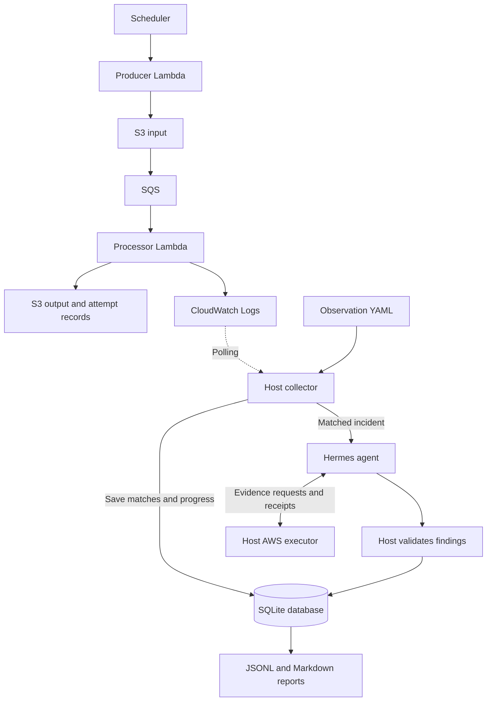

# Architecture

The pipeline writes files and logs. A separate collector watches the logs, and
Hermes investigates matches without changing the pipeline.

## Data flow



The producer writes five JSON records each minute, sometimes injecting bad data.
Run IDs come from the schedule; conditional writes prevent duplicate delivery
from replacing input. Scheduler and producer retries are disabled.

S3 sends input-file notifications to SQS. The processor accepts only the approved
queue, bucket, and input keys, rejects changed or oversized input, and doubles
numeric `amount` values. It writes these files, with no database destination:

```text
input/<run-id>.json
output/<run-id>.json
runs/<run-id>/<attempt-id>.json
```

Repeated delivery reuses the output key but creates a new attempt record.
SQS retries failed messages, then sends them to the dead-letter queue.
A failed record retries its whole SQS message.

Each Lambda has access only to its required S3 paths. Both emit JSON logs with
run IDs; processor logs add attempt and SQS IDs. Its final per-file `status`
drives detection. Input contents and queue bodies are not logged.

## Automatic investigations

`labctl` and systemd start the services. The collector uses
`/srv/hermes-lab/observations.yaml` for sources, match rules, and investigation
instructions. It reads CloudWatch without a content filter and applies literal
or Python `re` matches in a separate worker.

SQLite saves events, definitions, cursors, and pending work. Matches and page
progress commit together. Failed reads retain unread work; overlap deduplicates
events. Rule changes replay history without clearing incidents or attempts.

Lab run/attempt messages get scoped S3 and log tools. Plain-text matches need
no run ID and get log access within five minutes of the event. Both use the
same worker, budgets, and receipt checks. The host enforces access and validates
citations before saving findings; YAML cannot expand permissions.

Reports are generated from the incident database. A
reset archives findings and
the queue, keeps attempt budgets, and sets a new start that overlap cannot cross.

Default detection covers explicit processor file failures. It does not detect
producer failures, malformed notifications, queue outages, silent stoppages,
or overdue output. Delivery retries and investigation attempts are separate.

## Interactive chat

Chat uses the same worker, plugin, and executor with a resource scope rather
than one incident. Follow-ups share the remaining budget. Exit, expiry,
revocation, disconnect, or executor restart ends access; saved history cannot
restore it.

During chat, collection continues while automatic investigations wait without
spending attempts. Chat history stays under `/srv/hermes-lab/hermes/`; answers
are not automatically saved as findings. Automatic citations are host-validated;
chat citation use also relies on runtime instructions.

## Investigation limits

Chat and automatic investigations share the Hermes settings in
`investigator/runtime/config.yaml`: provider, model, reasoning, turn limit,
run budget, API retries, and recovery cycles. Deployment installs this file at
`/srv/hermes-lab/hermes/config.yaml`, mounted as `/opt/data/config.yaml` in the
runtime. The worker lets Hermes load these settings and explicitly selects the
`hermes_lab_aws` toolset, runbook, and CLI input/output mode. Host access budgets
and outer worker timeouts apply independently of Hermes settings.

| Setting                                  | Current value                                                           |
| ---------------------------------------- | ----------------------------------------------------------------------- |
| Collector tick / default source interval | 15 seconds / two minutes                                                |
| Initial lookback / default overlap       | 24 hours / five minutes, configured in YAML                             |
| Collection per invocation                | Five pages, 100 events/page, 60-second shared deadline                  |
| Catch-up windows                         | At most two hours each; saved backlog is not capped by initial lookback |
| Regex compile/evaluation                 | Three seconds per request; 256 MiB worker limit on Linux                |
| Automatic attempts                       | Three per rolling hour; three per incident                              |
| Work per poll / retry backoff            | One investigation / ten minutes                                         |
| Model budget                             | Ten iterations; 180 seconds                                             |
| Outer worker timeout                     | 240 seconds plus kill grace                                             |

Failed attempts count. `--retry-incident INCIDENT_ID` skips only backoff.
Chat and explicit verification are outside the automatic hourly limit.
There is no automatic
remediation or database retention policy.

## Code responsibilities

```text
pipeline/producer/         Scheduled input generation
pipeline/processor/       SQS consumption and processing
investigator/
  runbooks/               Model instructions
  runtime/                Deployment, containers, lifecycle, sessions
  collector/              Detection, storage, investigations, reports
  executor/               Trusted authorization, reads, audit, receipts
  plugins/                Hermes tools and socket client
evals/                    Manual live scenarios and runners
infra/                    Terraform and bootstrap
tests/                    Investigator and pipeline regression tests
```

Systemd runs the host collector; Hermes's internal gateway is stopped.
Sources poll when due, and catch-up or errors retry next tick. Active work,
including model calls, can delay polling. Evaluation tools are manual only.
Deployment packages do not grant additional container access.

## Health and storage

Host logs use stderr with UTC time, level, and module; JSON command results use
stdout. Lambda logs retain their matching fields. Logging is separate from
trusted audit records and receipts.

A one-minute timer checks services, disk, collection progress, exhausted
incidents, and a backup within 36 hours. Backup checks cache for one hour.
Intentional pause skips runtime checks but retains disk and backup checks.
Missing heartbeats alarm; healthy checks make no model calls.

SNS sends health and recovery alerts; findings stay local. The default host is
`t3.medium` with 30 GiB encrypted gp3 storage and daily backups.
It uses public IPv4 without NAT, a load balancer, or RDS. Stopping saves compute
charges; storage and other services remain billable. T3 Standard can throttle
sustained CPU use.
